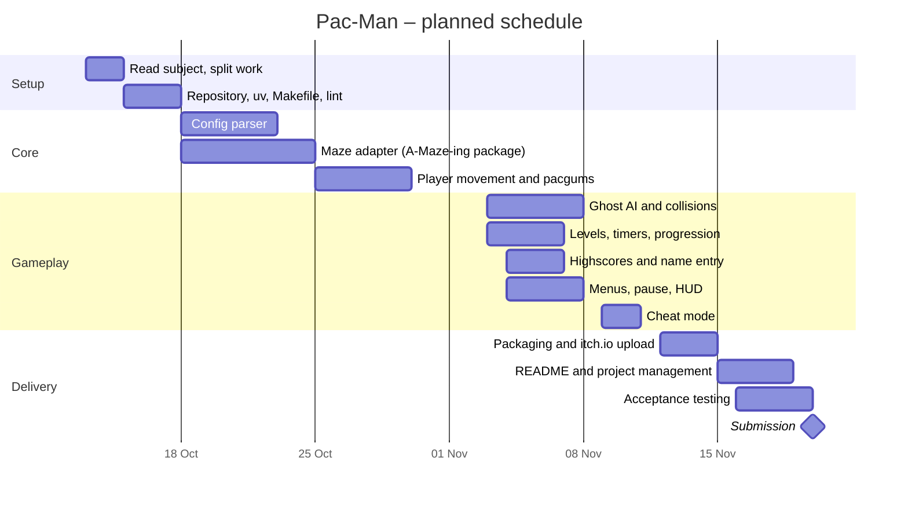

# Timeline

## Planned schedule

## Planned vs actual

| Milestone | Planned | Actual | Difference / reason |
| --- | --- | --- | --- |
| Project initialized | 2026-10-13 | 2026-10-13 | |
| uv setup, flake8, PyInstaller spec | 2026-10-18 | 2026-10-18 | |
| Assigned A-Maze-ing package imported | 2026-10-25 | 2026-10-24 | Completed 1 day early |
| Config parser, movement, scoring, levels, timers, pause | 2026-10-30 | 2026-11-01 | Completed 1 day late |
| Ghost AI, collisions, lives | 2026-11-06 | 2026-11-05 | Completed 1 day early |
| Menus, name entry, highscores, cheats | 2026-11-07 | 2026-11-05 | Completed 2 days early |
| Keyboard-layout bug fixed on lab machines | – (unplanned) | 2026-11-07 | See 07_blocking_points.md |
| Lint, packaging, config hardening, performance | 2026-11-15 | 2026-11-15 | |
| README | 2026-11-19 | 2026-11-15 | Completed 4 days early |
| Project management documents | 2026-11-19 | 2026-11-17 | Completed 2 days early |
| itch.io upload | 2026-11-15 | 2026-11-17 | Completed 2 days late |
| Submission | 2026-11-20 | 2026-11-17 | |

## Comments on the schedule

The schedule allowed a reasonable time for each task. Many tasks were completed early and only very few were completed 1 or 2 days late because of minor time and resource issues.
